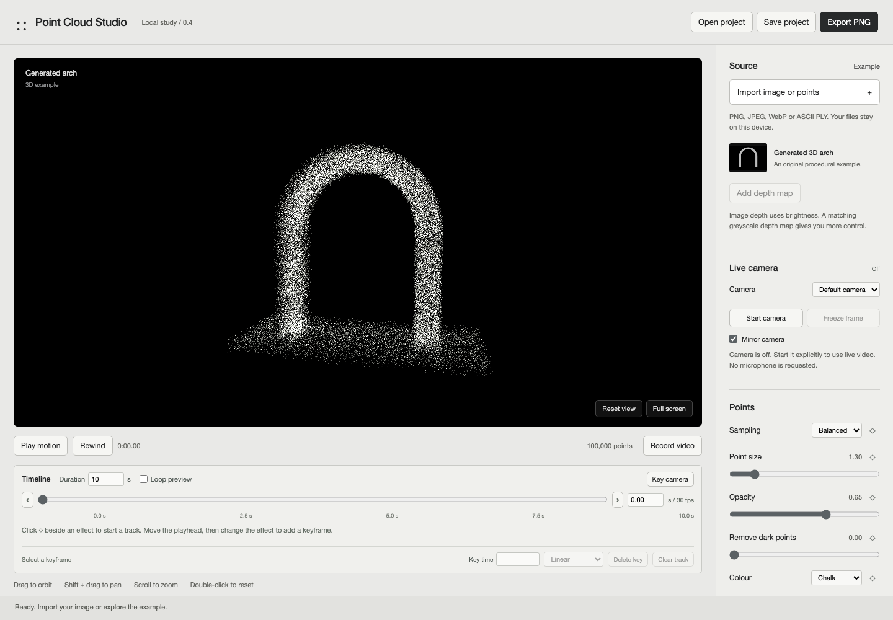

# Point Cloud Studio

A local browser tool by Corey Kavanagh for point-cloud artwork from images, ASCII PLY files, and live camera video. The checked-in version is `0.4.0` and remains experimental.



## Run locally

Use Node.js 22+ and a browser with WebGL2:

```sh
git clone https://github.com/notlestat/point-cloud-studio.git
cd point-cloud-studio
npm start
```

Open <http://127.0.0.1:4178>. On macOS, `Launch.command` also starts the local server and opens the page. Stop the server with Ctrl+C.

There are no runtime npm dependencies or build step. The server binds to loopback and serves an explicit list of application files. The app does not upload source media or require an account or API key.

Follow [Make and animate a point-cloud study](docs/make-a-study.md) for import, effects, keyframes, camera input, and export.

## Version 0.4 capabilities

| Area | Available in this checkout |
| --- | --- |
| Sources | PNG, JPEG, WebP, ASCII PLY, generated example, live camera |
| Treatment | Point size, opacity, colour, depth, scatter, waves, echoes |
| Motion | Effect and camera tracks, X/Y/Z artwork rotation, easing |
| Audio | Local-file response, without a microphone |
| Export | PNG, timed silent video, editable version 3 project files |

Image and camera brightness create shallow relief, not complete 3D reconstruction. A supplied depth map can control still-image relief. ASCII PLY supplies genuine 3D point coordinates.

Project files are explicit downloads. Refresh has no automatic recovery. Save before refreshing or replacing a session. Camera access starts only after an explicit action; saved projects never restore access automatically.

Video uses live browser timing and a supported MediaRecorder codec. It remains silent even when local audio drives the artwork. Physical-camera access, broad hardware compatibility, and sustained dense-cloud performance remain unverified.

## Check a change

Run the core tests without installing dependencies:

```sh
npm test
```

To run the browser suites, install their pinned dependency and Chromium:

```sh
npm ci
npx playwright install chromium
```

Keep `npm start` running in one terminal, then run `npm run test:browser` in another. Camera checks use a simulated device. [The verification record](verification/README.md) contains dated results and their limits.

## Find the implementation

| File | Purpose |
| --- | --- |
| [app.js](app.js) | Controls, sources, playback, recording |
| [core.js](core.js) | Source conversion and project validation |
| [settings.js](settings.js) | Defaults and bounds |
| [timeline.js](timeline.js) | Keyframes and interpolation |
| [renderer.js](renderer.js) | WebGL points and artwork rotation |
| [live-camera.js](live-camera.js) | Camera access and stream cleanup |
| [server.mjs](server.mjs) | Local server and file allowlist |

Keep settings, controls, timeline metadata, and rendering aligned when adding effects. Follow [AGENTS.md](AGENTS.md) for development rules. User media, saved studies, credentials, and generated captures stay out of Git.
